

  <picture>
    <source media="(prefers-color-scheme: dark)" srcset="docs/images/logo-dark.png">
    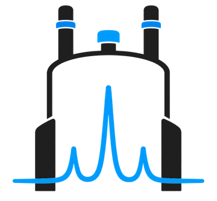
  </picture>

<h1 align="center">RESONANT</h1>

  <b>Controle de turno e registro automático de análises de RMN</b> 
  <i>Shift control and automatic logging of NMR analyses</i>

  
  
  
  

  <a href="https://github.com/thgdsrbrANJOS/resonant-releases/releases/latest"><b>⬇️ Baixar a versão mais recente / Download the latest version</b></a>

  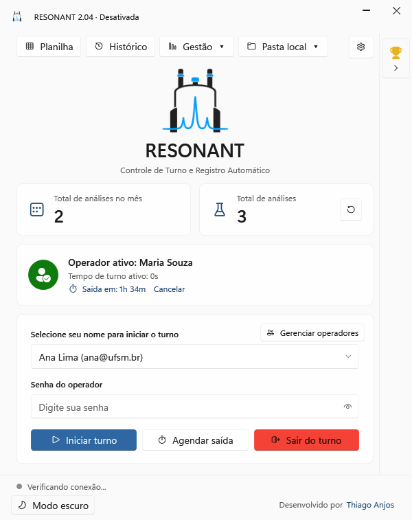

---

## 🇧🇷 Português

O **RESONANT** acompanha em tempo real as análises feitas no espectrômetro de RMN da Bruker (TopSpin e IconNMR). Cada experimento novo é identificado na hora, vinculado ao operador que está em turno e enviado automaticamente para uma planilha do Google Sheets. Não há anotação manual nem análise esquecida.

### Como funciona
1. **O operador inicia o turno.** Ele escolhe o nome na lista e digita a senha.
2. **O RESONANT observa as pastas da Bruker.** Quando o TopSpin grava um experimento, o programa lê os arquivos `acqus` e `title`: data, núcleo, pulso, solvente, instituição e solicitante.
3. **A análise é registrada.** Ela vai para o histórico local e para a planilha do Google. Sem internet, fica na fila e é enviada quando a conexão volta.
4. **Nenhuma análise se perde.** Se alguém usar o RMN sem fazer login, o RESONANT avisa na hora e registra a análise assim que um operador iniciar o turno.

### Destaques
- 🔗 **Conectar com Google em 1 clique:** o RESONANT cria a planilha e guarda os backups no Drive da conta do laboratório, com acesso apenas aos arquivos que ele mesmo cria.
- 🏆 **Ranking mensal dos operadores** por tempo de turno, com coroas de ouro, prata e bronze.
- 📊 **Total de análises no mês** e **total geral**.
- 🕒 **Saída de turno agendada**, por tempo ou ao fim da fila do espectrômetro.
- 🗂️ **Histórico completo**, com busca, filtros, exportação para Excel e sincronização.
- 📈 **Painel de uso** com gráficos: análises por dia e semana, por núcleo, por instituição, horários de pico e ocupação do espectrômetro.
- 🧾 **Relatórios mensais e anuais** em Excel, separados entre instituição interna e externas, com tempo de máquina e valores por tipo de análise.
- 🔐 **Senha de administrador protegida pelo Windows** e **backup automático** na própria planilha do Google.
- 🌗 **Visual do Windows 11**, com tema claro e escuro e em **português ou inglês**.
- 🔄 **Atualizações automáticas e seguras**, com assinatura digital conferida antes de instalar.

---

## 🇺🇸 English

**RESONANT** monitors the analyses run on a Bruker NMR spectrometer (TopSpin and IconNMR) in real time. Every new experiment is detected instantly, linked to the operator on shift and automatically sent to a Google Sheets spreadsheet. No manual notes, no forgotten analyses.

### How it works
1. **The operator starts a shift.** They pick their name from the list and enter their password.
2. **RESONANT watches the Bruker folders.** When TopSpin writes an experiment, it reads the `acqus` and `title` files: date, nucleus, pulse program, solvent, institution and requester.
3. **The analysis is logged.** It goes to the local history and to the Google spreadsheet. When offline, it is queued and sent once the connection is back.
4. **No analysis is lost.** If someone uses the NMR without logging in, RESONANT warns right away and records the analysis as soon as an operator starts a shift.

### Highlights
- 🔗 **One-click Connect with Google:** RESONANT creates the spreadsheet and keeps backups in the lab's own Google Drive, with access only to the files it creates itself.
- 🏆 **Monthly operator ranking** by shift time, with gold, silver and bronze crowns.
- 📊 **Analyses this month** and **all-time total**.
- 🕒 **Scheduled shift end**, after a set time or when the spectrometer queue finishes.
- 🗂️ **Full history**, with search, filters, Excel export and synchronization.
- 📈 **Usage dashboard** with charts: analyses per day and week, per nucleus, per institution, peak hours and spectrometer occupancy.
- 🧾 **Monthly and annual reports** in Excel, split between the internal institution and external ones, with machine time and prices per analysis type.
- 🔐 **Administrator password protected by Windows** and **automatic backup** in the Google spreadsheet itself.
- 🌗 **Windows 11 look**, with light and dark themes, in **Portuguese or English**.
- 🔄 **Safe automatic updates**: the digital signature is verified before installing.

---

## 🖼️ Telas / Screenshots

| Tela principal (claro) | Main screen (dark) |
|---|---|
|  | 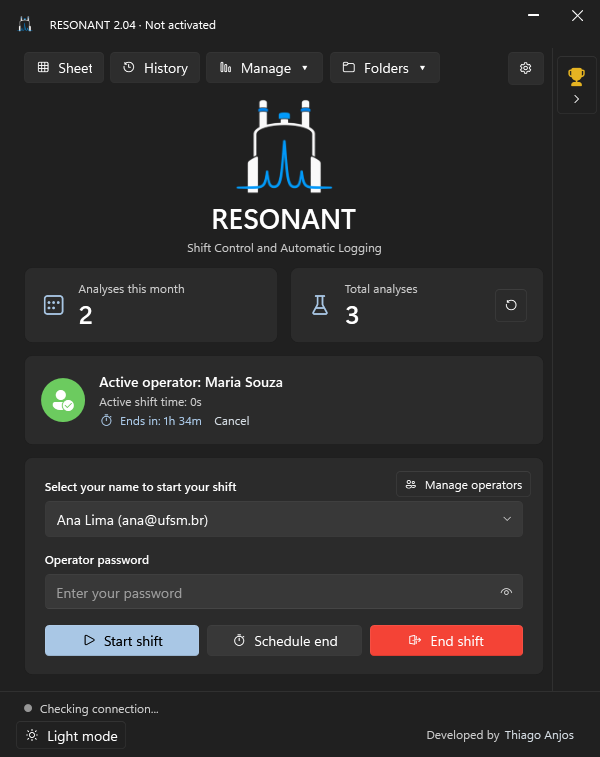 |
| **Histórico** | **History** |
| 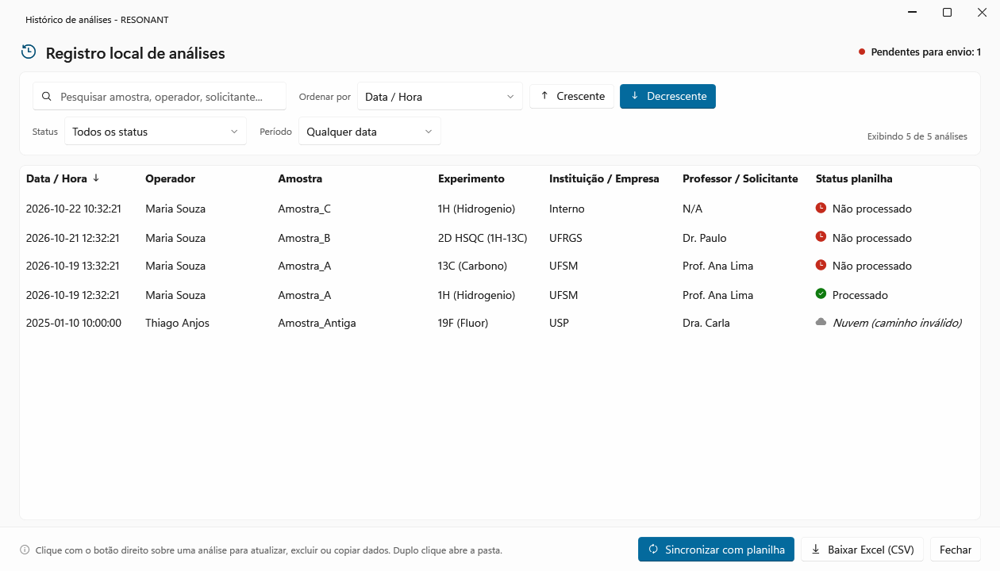 | 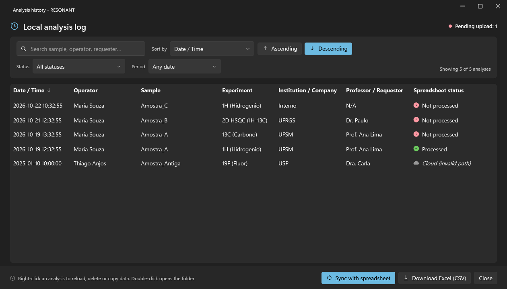 |
| **Painel de uso** | **Usage dashboard** |
| 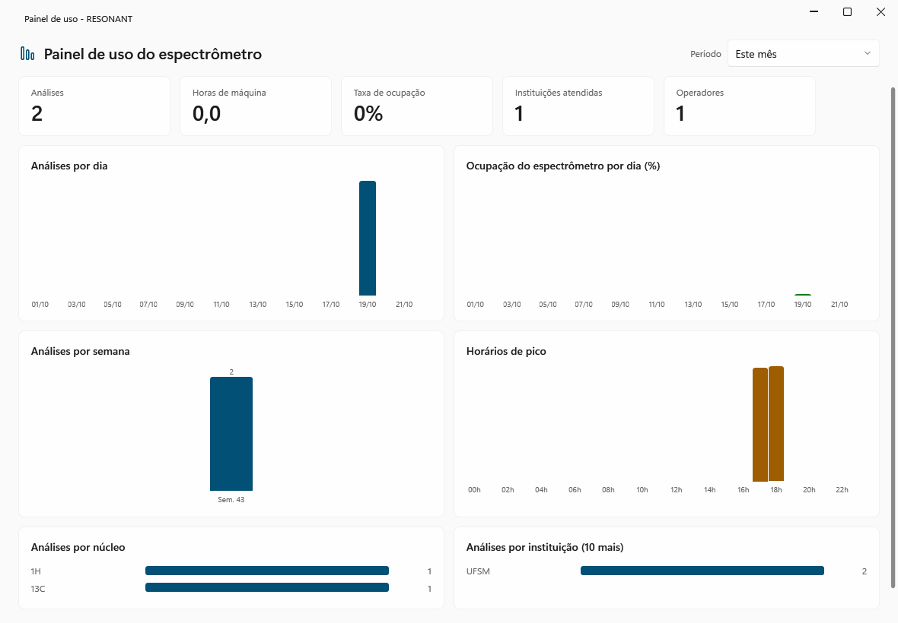 | 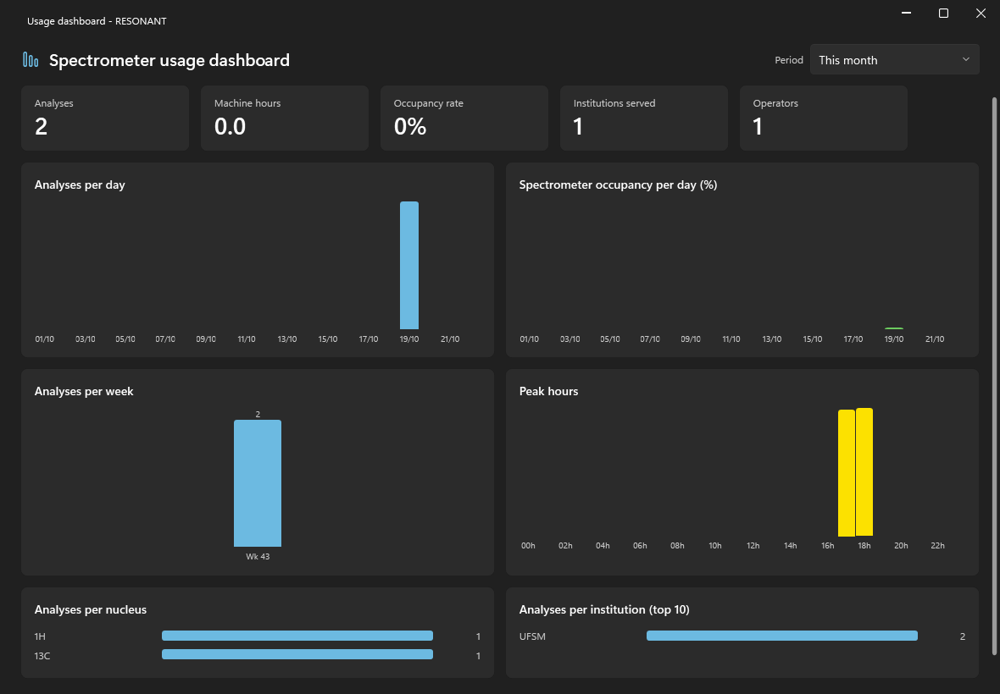 |
| **Ranking do mês** | **Activation** |
| 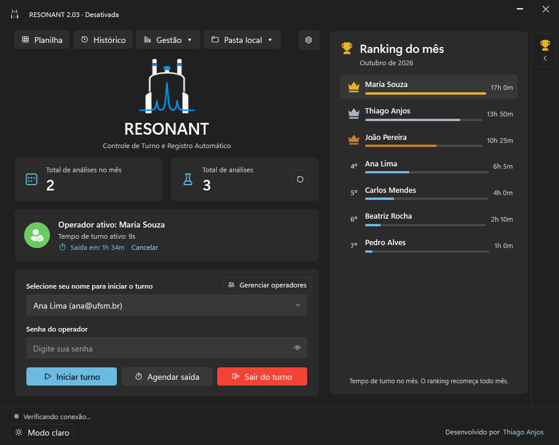 | 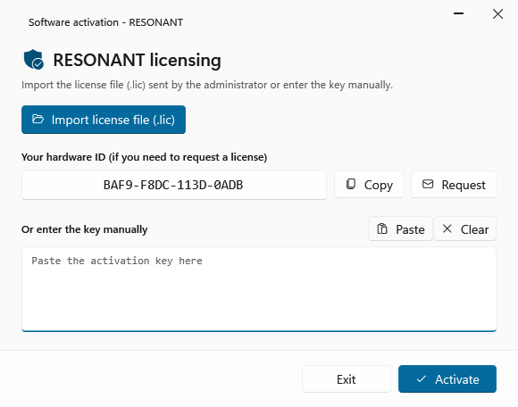 |
| **Conectar com Google** | **Title guide** |
| 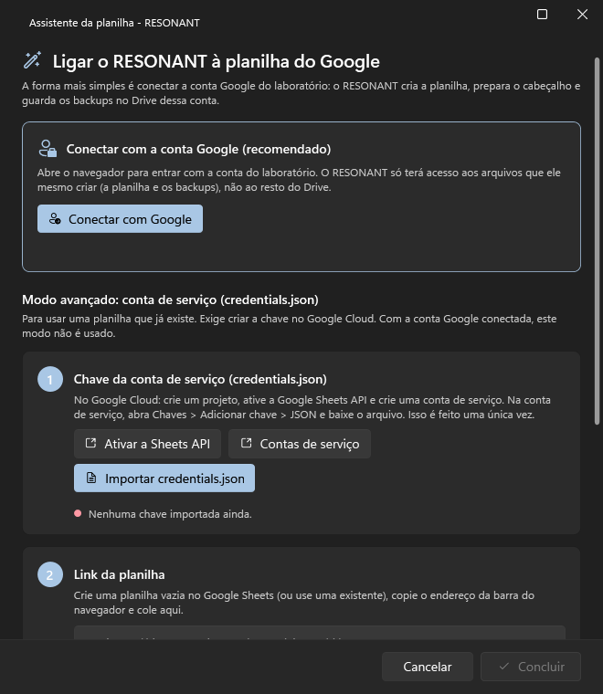 | 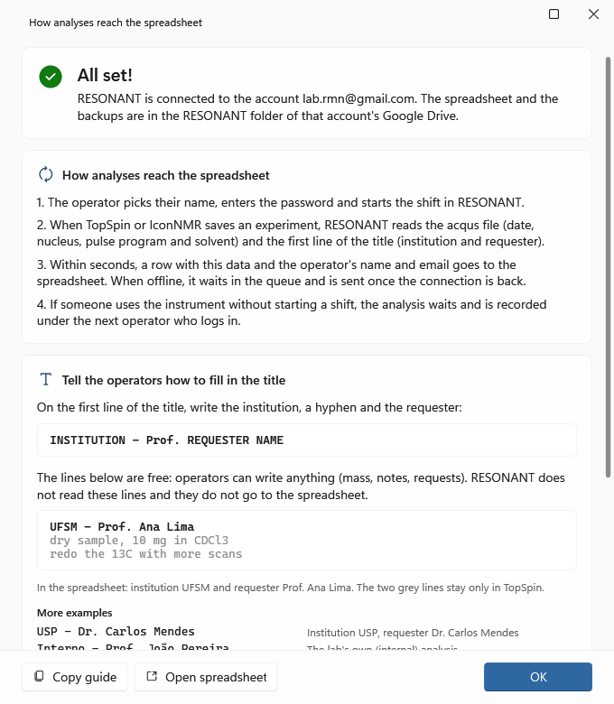 |
| **Configurações** | **Settings** |
| 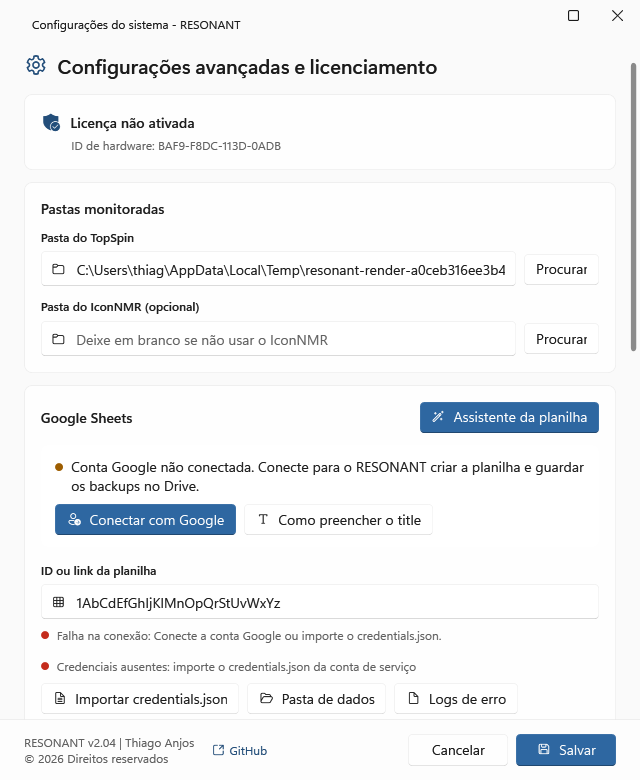 | 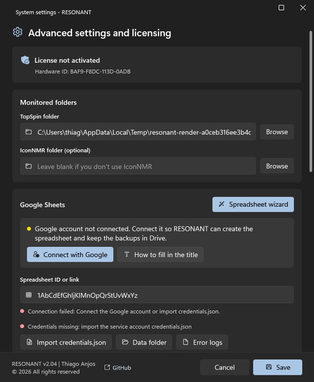 |

---

  Desenvolvido por / Developed by <b>Thiago Anjos</b> · © 2026 
  <a href="https://thgdsrbranjos.github.io/resonant-releases/">Site</a> · <a href="https://thgdsrbranjos.github.io/resonant-releases/privacidade.html">Política de Privacidade / Privacy Policy</a> · thgdsrbr@gmail.com

